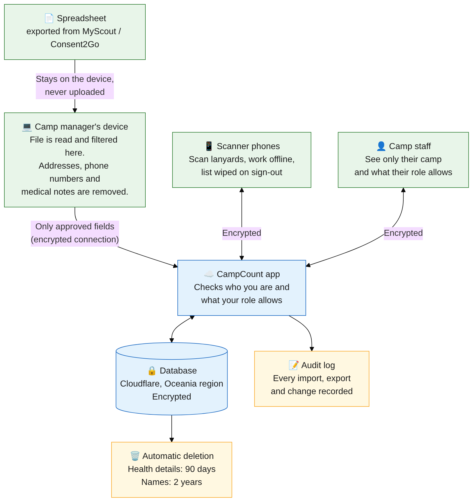

# CampCount database: a simple overview

## Where it is

- One database, hosted by Cloudflare and set to the Oceania region.
  (Cloudflare treats this as a preference, not a promise that it stays in
  Australia.)
- Only the CampCount app can reach it. There's no public address or password
  for the database.
- It's encrypted when stored and when sent over the internet.
- It can be restored to any point in the last 30 days.

## What it stores

| Group | What's kept |
|---|---|
| **People** | Name, membership number, section, group, position, photo consent |
| **Health** | Dietary needs and allergies, and medication consent answers. Only staff who need them can see them. |
| **Camp activity** | Lanyard scans (who, where, when), activity and team bookings, duties |
| **Camp setup** | Activities, meals and menus, scanning devices, lanyard designs |
| **Staff** | Name, email and role for each camp |
| **Audit log** | Who did what: imports, exports, changes, sign-ins |

## What it never stores

- Home addresses or phone numbers
- Medicare numbers or guardian details
- Free-text medical notes
- The imported spreadsheet
- Passwords or lanyard codes in readable form (these are scrambled)

## Keeping it safe

- Each camp's data is kept separate. Staff only see the camps they're
  assigned to, and only what their role allows.
- Scan records and the audit log can't be changed after they're written.

## When it's deleted (automatically)

| After the camp closes | Deleted |
|---|---|
| **90 days** | Dietary and health details, medication answers, photo consent |
| **2 years** | Names and attendance. Only anonymous totals are kept. |

## Still to fix

- Leaders' car registrations are kept for 2 years, not 90 days.
- A database restore hasn't been practised yet.
