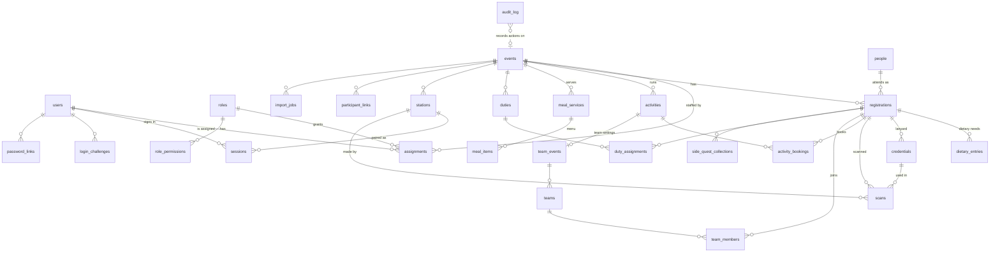

# CampCount database architecture

This describes the schema as built by `migrations/0001`–`0035`, not the
earlier draft in `architecture.md`.

## Platform

- **Engine:** Cloudflare D1 (SQLite), one production database
  (`campcount-production`). The application is the only way in. It runs as one
  Cloudflare Worker that reaches the database through a binding, so there's no
  public database endpoint, connection string or database password.
- **Location:** placed in the Oceania region by a location hint. Cloudflare
  doesn't treat this as a guarantee that data stays in Australia.
- **Encryption:** encrypted at rest by Cloudflare, and HTTPS in transit
  between the app and the browser. Lanyard QR tokens also get their own
  AES-256-GCM encryption in the app (see `credentials`).
- **Backup:** D1 Time Travel lets the database be restored to any point in the
  last 30 days.
- **Changes:** every schema change is a plain SQL migration, reviewed in Git
  and applied in order with `wrangler d1 migrations apply`.
- **Queries:** only parameterised prepared statements, with no ORM, so all SQL
  can be reviewed in the code.

## How it's organised

Data is either **platform-wide** (staff accounts, roles, the people list) or
**event-scoped**. Every event-scoped row carries `event_id`. The app takes
the event from the signed-in person's assignment, never from the request, and
every query filters on it. That keeps one camp's data apart from another's.

## Tables

Sensitivity: **High** = health information or children's data that needs
protecting. **Personal** = identifies a person. **Ops** = operational, no
personal data. **Security** = sign-in secrets, stored only as hashes.

### People and attendance

| Table | Holds | Sensitivity |
|---|---|---|
| `people` | Membership number (unique), first, preferred and last name. One row per person across all camps. | Personal |
| `registrations` | A person on one event: youth or adult, section, group, position, team, photo consent, status, and up to 12 extra imported columns (`extra_fields`). Leaders may also have a car registration. | Personal; `extra_fields` can be High |
| `dietary_entries` | Structured dietary needs: category (allergy, intolerance, medical diet, religious/cultural, preference), item, severity (standard or anaphylactic), and a note of up to 80 characters. | **High** |
| `credentials` | Lanyards: a SHA-256 hash of the QR token for lookup, the token encrypted with AES-256-GCM (to reprint), the typed code, and issued/revoked/printed times. | Security |
| `scans` | Who was scanned, where (activity, meal or site), in or out, how, device and server time, which staff member or station, and the outcome. **Append-only** (a trigger blocks updates). Corrections are new rows. | Personal |
| `activity_bookings`, `team_members`, `duty_assignments` | Who is booked on which activity, team or duty. | Personal |
| `side_quest_collections` | Which participants scanned each other in the optional Side Quest game. | Personal |

### Event setup (no personal data)

`events`, `activities`, `team_events`, `teams`, `meal_services`, `meal_items`
(menus and allergens), `duties`, `stations` (paired scanning devices),
`participant_links`, `lanyard_designs`, `lanyard_templates`,
`lanyard_assets`, `event_logos`, `event_banners`, and `import_jobs` (counts
only, never row data). `events.contact_email` holds the camp's contact
address.

### Accounts and access

| Table | Holds | Sensitivity |
|---|---|---|
| `users` | Staff accounts: email, display name, status, and a password hash (PBKDF2-SHA256 with a server-side pepper). | Personal / Security |
| `roles`, `role_permissions` | 5 built-in roles and their permissions. | Ops |
| `assignments` | Which staff member has which role on which event (or activity). Revoked rows are kept as history. | Ops |
| `sessions` | Server-side sessions, stored as a hash of the session ID. | Security |
| `login_challenges`, `password_links` | Emailed sign-in codes and links, stored as hashes. Codes expire after 10 minutes and allow 5 attempts. | Security |

### Audit

`audit_log` records sign-ins, imports, exports, role changes, corrections
and retention purges. Database triggers block **any edit**, and block
deletion until a row is **7 years** old. The `detail` field holds IDs and
counts only, never names, dietary details or contact details.

## What isn't in the database

- Home addresses, phone numbers, Medicare numbers or guardian details. The
  import schema rejects any field not on its allowlist.
- Free-text medical notes. These are read on the importing staff member's
  device, and only a keyed hash (`dietary_source_hash`) is stored, so the app
  can tell when the note has changed.
- The imported spreadsheet itself.
- Raw QR tokens, passwords, session IDs or sign-in codes in plain text.

## Retention (automatic, daily at 03:17 UTC)

| When | What's removed |
|---|---|
| 1 day after expiry | Sign-in codes and expired sessions |
| 7 days | Self sign-ups that never confirmed their email |
| **90 days after a camp closes** | All dietary entries, photo consent, extra imported columns (including medication answers), Side Quest data, and the encrypted lanyard tokens (lanyards are revoked) |
| **2 years after a camp closes** | Registrations, scans, bookings, lanyards and stations. Only anonymous totals are kept (`events.archive_summary`). People not on any other camp are then deleted. |
| 7 years | Audit log entries can then be deleted |

Every purge is written to the audit log.

## Known gaps

- `registrations.car_rego` (leaders' car registrations) isn't cleared at
  90 days. It stays until the 2-year purge.
- Data location is a hint, not a guarantee (see Platform).
- Restore from Time Travel hasn't yet been rehearsed on the live account.
